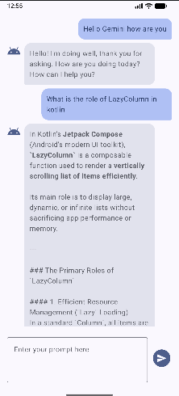
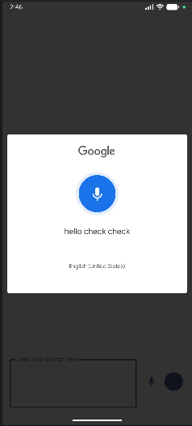
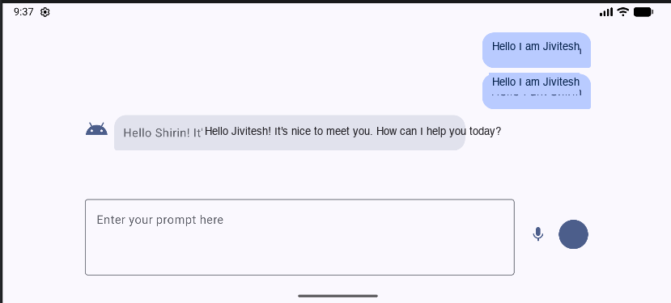
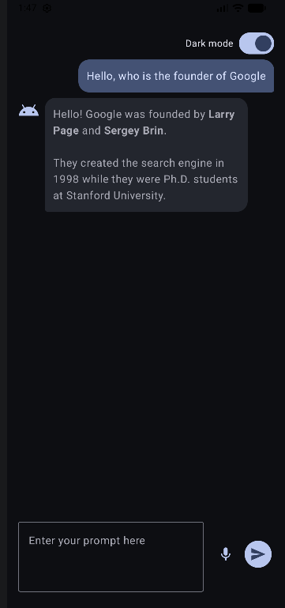
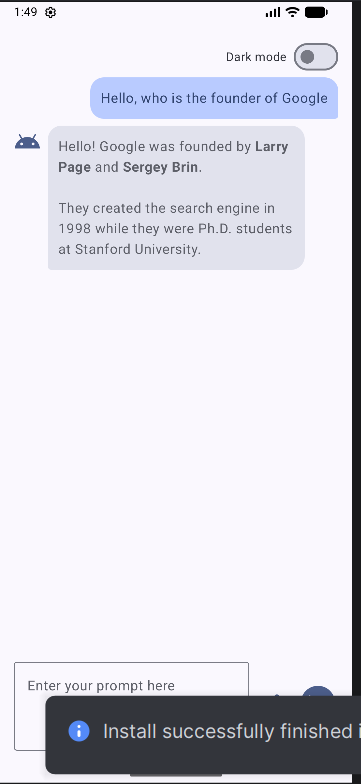
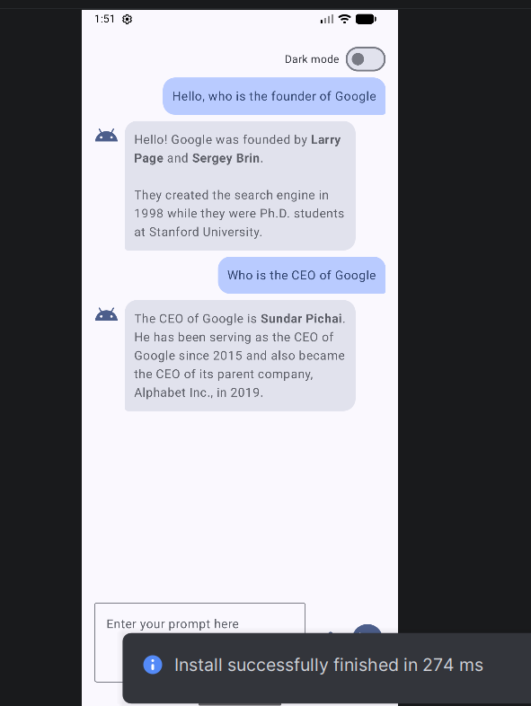
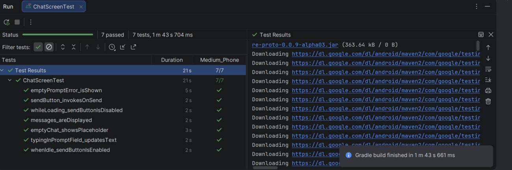

# Gemini Chat (Jetpack Compose)

**Name:** Jivitesh Dutt  
**Roll No:** N026  
**Program & Branch:** MBATech Computer Engineering (Batch D1)  
**Course:** Mobile Application Development (Subject Code - 702AI0E002)  
**Institution:** SVKM's NMIMS University, School of Technology Management & Engineering, Mumbai

A Gemini-powered chat application built with Kotlin and Jetpack Compose, extended from the course starter project.

## Features
- **Material 3 Chat UI**: Conversation rendered in a `LazyColumn` with distinct Material 3 message bubbles (user vs. Gemini), stable keys, and automatic scrolling to the newest message.
- **Loading & Error Handling**: Displays a `CircularProgressIndicator` while awaiting responses, disables send action during generation, and presents friendly errors via `SnackbarHost`.
- **Speech-to-Text Input**: Expand input modalities with voice input using `RecognizerIntent` launched via `rememberLauncherForActivityResult`.
- **Responsive Layout**: Uses `WindowSizeClass` (`WindowWidthSizeClass`) with adaptive modifiers so the chat layout cleanly scales across portrait phones, landscape mode, and large tablet screens (max content width centered at 720dp).
- **Dark Mode Preference**: Includes a dark mode toggle switch persisted across app launches via Preferences DataStore, defaulting to the device's system theme (`isSystemInDarkTheme()`).
- **Chat History Persistence**: Integrates a Room Database (`AppDatabase`, `ChatDao`, `MessageEntity`) so multi-turn chat conversations survive app restarts.
- **Multi-turn Context**: Maintains conversation history and sends it to the Gemini model using `startChat(history = pastContent)`.
- **API Key Security**: Keeps keys out of VCS, supports environment variable fallback for CI, encrypts keys at rest using Android Keystore AES-256-GCM, and applies R8 code/resource shrinking in release builds.

## Screenshots

| Portrait Chat & Scrolling | Voice Input (STT) |
| :---: | :---: |
|  |  |

| Responsive Tablet Layout (WindowSizeClass) |
| :---: |
|  |

| Dark Mode (DataStore Preference) | Light Mode |
| :---: | :---: |
|  |  |

| Multi-turn Chat Context | UI Test Results (7/7 Passed) |
| :---: | :---: |
|  |  |

## Setup
1. Obtain an API key from [Google AI Studio](https://aistudio.google.com).
2. Copy `local.properties.example` to `local.properties` in the project root:
   ```properties
   GEMINI_API_KEY=your_api_key_here
   ```
   *(Note: `local.properties` is listed in `.gitignore` and is never committed to Git).*
3. If building in CI environments where `local.properties` is omitted, supply the key via the `GEMINI_API_KEY` environment variable.
4. Open the project in Android Studio, sync Gradle, and run the `app` configuration.

## How the API Key is Protected
- **Never Hardcoded**: The key is not stored in Kotlin source files, XML resources, or committed Gradle scripts. It is read at build time by Gradle and injected into `BuildConfig.GEMINI_API_KEY`.
- **Encrypted at Rest**: On first launch, `ApiKeyStorage` uses `KeystoreCipher` to generate an AES-256-GCM key inside the hardware-backed **Android Keystore** (`AndroidKeyStore`). The key never leaves the Keystore. Only the resulting ciphertext and IV are persisted in DataStore (`secure_prefs`).
- **In-Memory Decryption**: The key is decrypted in memory only when initializing `GenerativeModel` and is never logged or exposed.
- **R8 Obfuscation & Shrinking**: Release builds enable `isMinifyEnabled = true` and `isShrinkResources = true` to obfuscate byte-code and remove unused code/resources.

### Production Security Limitations & Best Practices
Client-side encryption raises the barrier against casual inspection, but cannot fully protect secrets from a determined attacker with root access, memory inspection tools, or reverse-engineering toolkits. In a production environment:
1. **Backend Proxy**: Move Gemini API calls behind a secure backend application server (e.g., Cloud Functions / Cloud Run). The mobile app authenticates users and makes requests to the backend, which holds the Gemini API key in Secret Manager.
2. **App Attestation**: Integrate **Firebase App Check** (using Play Integrity on Android) to verify that incoming API traffic originates from an authentic, untampered mobile application.
3. **API Key Restrictions**: Enforce IP, referrer, or package fingerprint restrictions on Google Cloud Console.

## Tests
- **Unit Tests**:
  - Tests `ChatViewModel` logic using `kotlinx-coroutines-test`, `StandardTestDispatcher`, and fake repository implementations (`FakeGeminiRepository`, `FakeChatHistory`).
  - Run via Gradle:
    ```bash
    ./gradlew testDebugUnitTest
    ```
  - Or in Android Studio: Right-click `ChatViewModelTest` and choose **Run**.
- **Compose UI Tests**:
  - Validates `ChatScreen` composables using `createComposeRule()` (placeholder visibility, message rendering, send callbacks, input text updating, validation errors, and button loading state).
  - Run via Gradle on an active emulator or connected device:
    ```bash
    ./gradlew connectedDebugAndroidTest
    ```
  - Or in Android Studio: Right-click `ChatScreenTest` and choose **Run**.

## Tech Stack
- **Language**: Kotlin 2.0
- **UI Toolkit**: Jetpack Compose & Material 3
- **Architecture**: MVVM with StateFlow, Coroutines, and `collectAsStateWithLifecycle()`
- **Persistence**: Room Database with Google KSP (`androidx.room`) & Preferences DataStore (`androidx.datastore`)
- **Security**: Android Keystore (`KeyGenParameterSpec`, AES-256-GCM), R8 Proguard/Minification
- **AI SDK**: Google Generative AI SDK (`com.google.ai.client.generativeai`)
- **Testing**: JUnit 4, `kotlinx-coroutines-test`, Compose UI Testing (`androidx.compose.ui.test.junit4`)
